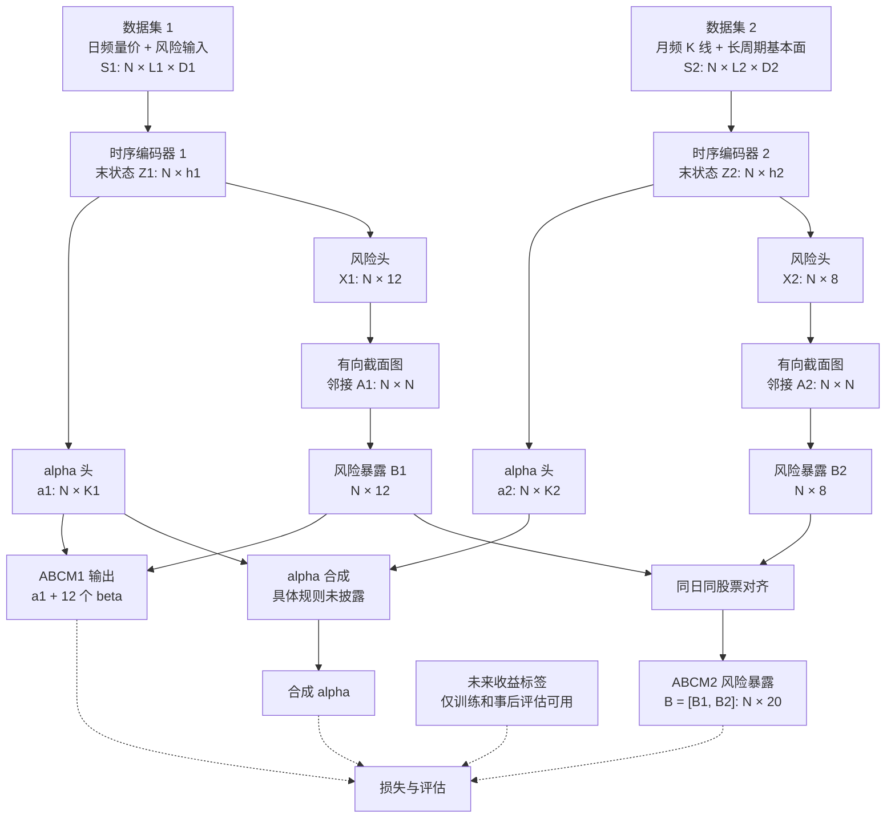
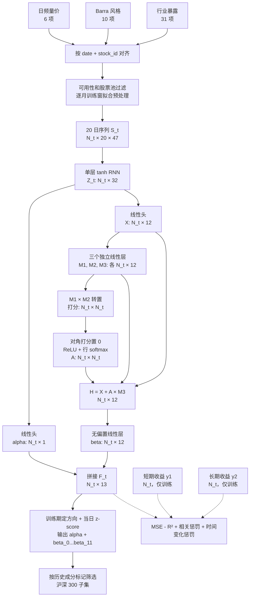

> 要点：同一日截面内，RNN 提取个股时序状态，alpha 由独立线性头生成，12 个 beta 由有向稠密图生成；原始收益监督、联合解释度、相关惩罚和时间平滑共同训练。下文以【原文】、【项目设定】和【推导】区分信息来源。本文聚焦已实现的 ABCM1；ABCM2 的月频分支尚无足够原文细节可据此重建。 #ABCM #因子模型 #图神经网络

## §1 问题与符号

【原文】希望同时生成有选股能力的 alpha 和解释未来收益截面变化、相对稳定的风险因子。旧框架先中性化 alpha 标签，可能丢失信息；只让风险因子最大化收益解释度，也可能使其吸收选股信息。因此新框架让两类因子共同解释原始收益，并使风险分支聚合其他股票的信息。

令交易日为 $t$，当日有效股票数为 $N_t$，历史窗口长度为 $L$，输入维数为 $D$。
输入张量 $S_t\in\mathbb R^{N_t\times L\times D}$；短期和较长期原始收益标签分别为 $y_{1,t},y_{2,t}\in\mathbb R^{N_t}$。
输出 $a_t\in\mathbb R^{N_t\times1}$、$B_t\in\mathbb R^{N_t\times12}$，拼接 $F_t=[a_t,B_t]\in\mathbb R^{N_t\times13}$。模型参数统记为 $\theta$。

【项目设定】$L=20,D=47$：
6 项日频量价、10 项 Barra 风格和 31 项行业暴露；
$y_{1,t}=C_{t+11}/C_{t+1}-1$，$y_{2,t}=C_{t+21}/C_{t+1}-1$，其中除法逐股票进行。
标签定义是从研报评估期限作出的实现解释，研报没有完整公布训练标签的构造式。
完整交易日截面为一个 batch；仅使用当时可得的特征，训练边界须为未来标签留足 21 个交易日。训练结束后生成当日因子不需要未来收益。

## §2 前向传播

【原文与项目设定】每只股票共享一套单层 vanilla tanh RNN 参数。对股票 $i$、窗口步 $\ell$，
$$h_{i,\ell}=\tanh(W_xs_{i,\ell}+W_hh_{i,\ell-1}+b),\qquad z_i=h_{i,L}\in\mathbb R^{32}. $$
为什么选择的是 $\operatorname{\tanh}$？
Alpha： $a_i=w_a^\top z_i+b_a$.
Intermedia: $x_i=W_rz_i+b_r\in\mathbb R^{12}$, $X\in\mathbb R^{N_t\times12}$ 由 $x_i$ 堆叠。
三套互不共享的线性变换给出 $M_j=XW_j+\mathbf1b_j^\top\in\mathbb R^{N_t\times12}$，$j=1,2,3$。
记 $Q=M_1M_2^\top\in\mathbb R^{N_t\times N_t}$，$G=\operatorname{ReLU}(Q)$。

【项目设定】先把 $G$ 的对角打分置零，再逐行 softmax：
$$A_{ij}=\frac{\exp(\widetilde G_{ij})}{\sum_k\exp(\widetilde G_{ik})},\quad \widetilde G_{ii}=0,\qquad H=X+AM_3,\qquad B=HW_2.$$

$W_2\in\mathbb R^{12\times12}$ 不带偏置。$A$ 一般不对称；$H$ 的残差项保留个股自身信息。

注意：**对角打分为零之后再 softmax，$A_{ii}$ 仍严格大于零**。原文公式如此写，但文字称“剔除自身影响”，两者并不等价；真正排除自环须在 softmax 前将对角设为 $-\infty$。当前交付模型配置为 `self_loop_policy=zero_score`，不能描述为严格无自环。图矩阵每个截面占 $O(N_t^2)$ 空间，改变股票池也会改变同一股票的 beta 输出。

## §3 目标函数及可微估计

【原文】展示了 $\mathrm{MSE}(a,y_1)+\mathrm{Rsquare}(F,y_2)+\lambda\|\operatorname{corr}(F,F)\|+TO(B)$，其中

$$\widehat c=(F^\top F)^{-1}F^\top y_2,\qquad R^2=1-\frac{\|y_2-F\widehat c\|_2^2}{\|y_2\|_2^2}.$$

这里的 $\widehat c\in\mathbb R^{13}$ 是每个截面内重新求解的辅助 OLS 系数，并非网络参数；$F$、$A$、$H$ 也是由参数和输入计算的中间量。公式没有截距，分母也没有中心化，故这是**无截距解释度**。若 $F^\top F$ 奇异，原式无定义。

【项目设定】梯度下降的实际目标取
$$\mathcal L_t=\underbrace{N_t^{-1}\|a_t-y_{1,t}\|_2^2}_{L_{\rm MSE}}-R_t^2+0.1\|\operatorname{corr}(F_t,F_t)\|_F+\underbrace{\operatorname{mean}_{i,k}|B_{i,k,t}-B_{i,k,t-1}|}_{L_{\rm TO}},$$

其中换手项仅对两日都有观测的股票计算。相关矩阵的范数暂按**包含对角线的 Frobenius 范数**解释；换手项是因子暴露变化，不是组合交易换手。两者原文均未给精确定义。原文把 $R^2$ 写成正号而未说明优化方向；若按普通梯度下降最小化正 $R^2$，会压低解释度，故项目采用负号，并明确标为实现假设。$\lambda=0.1$、Adam、学习率等也属于项目选择。

**※【性质】** 在 $F$ 满列秩、$y_2\ne0$ 时，令 $c=\widehat c,e=y_2-Fc,d=\|y_2\|^2$。OLS 正交性 $F^\top e=0$ 消去 $dc$ 项，从而
$$dR^2=\frac{2}{d}e^\top(dF)c,\qquad \nabla_F(-R^2)=-\frac{2}{d}ec^\top.$$

MSE 对 alpha 输出的梯度为 $2(a-y_1)/N_t$。故 alpha 头接受 MSE、$-R^2$、相关惩罚的梯度；风险头及图参数接受 $-R^2$、相关惩罚和换手项的梯度；共享 RNN 接受两支梯度之和。对一行 softmax，$\partial A_{ij}/\partial G_{ik}=A_{ij}(\mathbf1_{j=k}-A_{ik})$；再由 $Q=M_1M_2^\top$ 和 $H=X+AM_3$ 按链式法则回传。ReLU 在负打分处梯度为零，绝对值在零处取次梯度。自动微分可处理 `solve`，但接近奇异时梯度会很大；项目用线性求解而不显式求逆，并记录条件数。

**※【性质】** 对任意可逆 $13\times13$ 矩阵 $T$，$F$ 与 $FT$ 张成同一列空间，因此上述 $R^2$ 相同。仅靠 $R^2$ 无法识别单个因子的名称、尺度和方向；MSE、分支结构与惩罚虽限制部分等价解，也不能数学上保证 beta 不含选股信息。包含相关矩阵对角线使范数存在固定基线；最小化它也不等于强制因子正交。

## §4 一次可手算的局部示例

**※【例题】** 为展示图聚合，暂用 $N=2,M=1$，取 $X=M_1=M_2=M_3=(1,2)^\top$，对角打分置零、ReLU 后 $G=\begin{psmallmatrix}0&2\\2&0\end{psmallmatrix}$。记 $p=e^2/(1+e^2)\approx0.881$，则 $A=\begin{psmallmatrix}1-p&p\\p&1-p\end{psmallmatrix}$，$H=X+AX\approx(2.881,3.119)^\top$。这个例子直观看出两个正的自环权重 $1-p$。

再仅看 alpha 的 MSE 更新：设 $a=(0.2,0.4)^\top$、$y_1=(0.3,0.1)^\top$，则 $L_{\rm MSE}=((-.1)^2+.3^2)/2=.05$，$\nabla_a L=(-.1,.3)^\top$。若把 $a$ 暂作直接可调输出，以学习率 $0.1$ 做一步梯度下降，得到 $a'=(.21,.37)^\top$、$L'=(.09^2+.27^2)/2=.0405$。实际网络更新的是 $\theta$，须把此梯度继续乘各层 Jacobian；此简例并未计算 OLS、相关和换手项。

## §5 训练、推理与研究结论

【项目设定】现有 2026 年因子生产使用全A可用截面，月末从零重训扩展历史窗；冻结配置是单层 RNN hidden=32、20 日输入、12 个 beta、`zero_score`、`fill=0`、Adam 学习率 $10^{-4}$、8 个 epoch、随机种子 20261018。每次标准化仅在当次训练窗拟合，训练标签跨月边界的锚定日 purge 21 个交易日。9、10、11 月模型分别用截至 2026-08-31、09-30、10-30 的窗口训练，随后只推断紧接月份。月度 alpha/beta 的方向由训练窗尾部 RankIC 决定；输出的可交易版本再做当日截面 z-score。以上是**我们的生产协议**，研报没有披露这些参数或逐月重训频率。

【原文实验】报告在沪深300上的 ABCM1/ABCM2 滚动解释度约 43.90%/47.02%，Barra 为 41.97%；alpha 与指数增强另有表现比较。这些是报告的数据与协议下的经验结果，不是本地实现的理论保证。研报也未完整给出训练/验证/测试日期、数据快照时点、优化器和输入字段清单，无法以其曲线反推训练频率。

【独立分析】样本外因子应检验跨期 RankIC、beta 自相关、因子间相关与收益解释度，并另行检验组合成本后的表现；这些指标回答不同问题。新环境中要重新确认数据发布时点、股票池及标签成熟日，再在过去窗口选参、锁定配置、滚动重训和前向推理。价格与 Barra 历史快照若事后修订，时间切分本身不足以保证无泄漏。

# ABCM 数据与模型流程图
## 1. 研报：ABCM1 与 ABCM2 总览

研报明确的是数据集 1 产生 12 个风险因子、数据集 2 产生 8 个，ABCM2 合计 20 个。`L1、L2、D1、D2、h1、h2、K1、K2` 的具体数值、月频到日频的映射和 alpha 合成算法未完整披露；图中的相应节点是概念表达，不表示我们已实现月频分支。虚线代表训练和评估所需的信息，不是生成当日因子的推理输入。

## 2. 我们的 ABCM1：从数据到因子

其中 $X,M_1,M_2,M_3,H,B\in\mathbb R^{N_t\times12}$，$A\in\mathbb R^{N_t\times N_t}$。实际模型的 `zero_score` 是**对角打分置零**：softmax 后 $A_{ii}>0$，不能理解为完全移除自环。训练标签的项目定义为 $y_{1,i,t}=C_{i,t+11}/C_{i,t+1}-1$、$y_{2,i,t}=C_{i,t+21}/C_{i,t+1}-1$。生成日只用截至 $t$ 的特征。

项目冻结设定为 `lookback=20`、`input_dim=47`、`hidden=32`、`alpha_count=1`、`beta_count=12`、`fill=0`。训练使用全 A 可用股票截面；沪深 300 文件是因子生成后的历史成分子集。月末用截至上月的数据从零重训，标签尚未成熟的末尾锚定日按 21 个交易日剔除。Barra 是否具有真正的历史时点快照属性，仍需依据数据供应记录核实。

